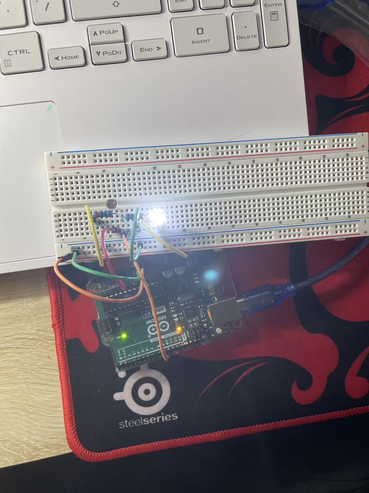

# Intelligent Lamp

Intelligent Lamp is an Arduino-based lighting system that detects ambient light and automatically adjusts the brightness of an LED.

The project was created for students and office workers who spend long periods studying or working. Fixed lighting may become too bright or uncomfortable when a light is first turned on, when daylight changes, or when the surrounding environment becomes darker. Intelligent Lamp responds automatically to these changes, reduces the need for manual adjustment, and helps maintain stable and comfortable lighting conditions.

When the system starts, it spends approximately five seconds observing the surrounding light level and establishing an initial calibration range. The photoresistor connected to analog pin A0 continuously measures ambient light, while an exponential moving-average filter reduces sudden fluctuations in the sensor readings. The filtered value is converted into a PWM output for the LED on pin 9. A deadband and gradual brightness adjustment are used to reduce flickering and prevent abrupt changes in light intensity.

The system was developed using Arduino IDE and Arduino C/C++. It combines photoresistor sensing, electronic circuit assembly, PWM brightness control, exponential moving-average filtering, automatic light calibration, gradual brightness adjustment, and serial-monitor debugging.

The hardware prototype, ambient-light detection, and automatic LED brightness control have been completed and tested. Future improvements will focus on refining the brightness-control algorithm, improving the circuit layout, and designing a complete lamp enclosure.

▶️ [Watch the Intelligent Lamp demonstration video](media/intelligent-lamp-demo.mp4)
